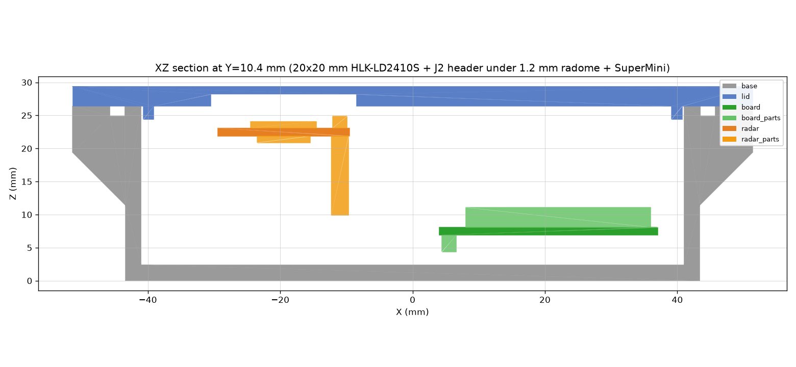
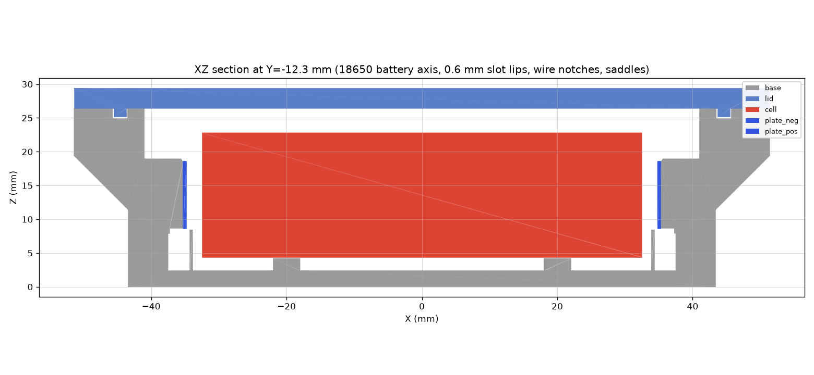

# Steam-Proof Bathroom & Outdoor Presence Sensor Enclosure (Bambu Lab A1)

3D-printable, gasketed enclosure for the **SuperMini nRF52840** (`nice!nano v2` clone), **Hi-Link HLK-LD2410S** 24 GHz mmWave human presence radar (`20.00 × 20.00 × 1.20 mm` square PCB with `R = 2.00 mm` corners and `2.54 mm` 5-pin `J2` header), and one unprotected **18650 Li-ion cell**, featuring a **100% solid outer lid face with a blind `1.2 mm` RF radome window** over the 24 GHz patch antenna array so bathroom shower steam cannot enter the enclosure.




## Files

| File | Use |
| :--- | :--- |
| `out/base.step`, `out/lid.step` | **Import into Fusion / CAD** (`File → Open`). Each is a single watertight solid body (`solids=1`). |
| `out/assembly.step` | Base + lid in their assembled positions. |
| `out/fit_check.step` | Assembly plus high-fidelity dummy 18650 cell, contact plates, SuperMini nRF52840 (with `-Z` through-hole pin rows & `B+`/`B-` solder tails), and `20 × 20 mm` HLK-LD2410S radar (with `-Z` `J2` 5-pin header shroud/pins, `+Z` solder tails, `ICL1112` SoC, and `-Z` `YXC 3225` crystal). |
| `out/base.stl`, `out/lid.stl` | Ready to slice in Bambu Studio / OrcaSlicer. `lid.stl` is already flipped top-face-down for a smooth bed finish and supportless printing. |
| `out/sections/*.png` | 10 annotated 2D cross-sections (`z_mid_cell`, `z_board`, `z_radar`, `z_radome`, `z_flange`, `y_battery`, `y_electronics`, `x_center`, `x_radar`, `x_board`). |
| `enclosure.py` | **Parametric CadQuery source.** All dimensions are named constants at the top of the file. |
| `verify.py` | Rebuilds all STEP/STL files and runs automated boolean interference, solid validity, `+` contact reach, and `1.2 mm` radome thickness checks. |
| `sections.py` | Re-renders all 10 2D cross-section PNGs in `out/sections/`. |

## Regenerating & Verifying After Parameter Edits

```bash
python3 -m venv .venv && .venv/bin/pip install -r requirements.txt
.venv/bin/python verify.py      # rebuilds out/*.step and out/*.stl, verifies 0.000 mm^3 overlap
.venv/bin/python sections.py    # re-renders out/sections/*.png
```

`enclosure.py` enforces design rules in `check()` before exporting:
- Exact HLK-LD2410S PCB dimensions (`20.0 × 20.0 × 1.2 mm`, `R = 2.0 mm` corners) and `19.5 mm` `-Z` clearance for the `2.54 mm` 5-pin `J2` header and wiring.
- `+` battery contact dimple reach past the `0.6 mm` retaining lips (`0.50 mm >= 0.30 mm`).
- Gasket groove clearance to the four blind M3 heat-set insert bosses (`>= 1.0 mm`).
- Blind RF radome thickness (`RADOME_T = 1.2 mm`, `22.0 × 22.0 mm` pocket) and `5.10 mm` antenna-to-radome air gap for unobstructed $\pm 60^\circ$ FOV.

## Mechanical Design Highlights

- **Cavity (`82.0 × 48.0 × 24.0 mm`)**:
  - **`-Y` Lane — 18650 Battery Bay**: Holds one unprotected flat-top 18650 cell (`Ø18.4 × 65.0 mm`) on two contoured saddles (`X = ±20.0 mm`). Nickel contact plates (`12 × 12 × 0.5 mm`, e.g. Keystone 5209 / leaf-spring + dimple pair) slide vertically into `0.8 mm` slots in the end blocks with `4.0 × 5.0 mm` rear wire exit notches. The front retaining lips are **`0.6 mm` thick** (`BLOCK_LIP = 0.6 mm`) so the `+` cap (`0.4 mm`) + plate dimple (`1.0 mm`) reach `0.50 mm` proud of the plastic lip face.
  - **`+Y` Lane (`+X` Side) — Zero-Collision SuperMini nRF52840 Cradle (`X = +20.5 mm`)**: Elevates the `33.0 × 18.0 × 1.2 mm` PCB by **`BOARD_RAIL_H = 4.5 mm`** on 4 corner pads (outside the `28.0 mm` 12-pin rows) plus two inset longitudinal rails inside the pin rows. This leaves the entire `0.0 .. 2.2 mm` `±Y` through-hole pin rows and `-X` `B+`/`B-` pads completely unobstructed underneath (`2.0 mm` vertical clearance below `2.5 mm` solder tails) with wide-open `-X` and `-Y` cable routing channels.
  - **`+Y` Lane (`-X` Side) — Zero-Collision HLK-LD2410S Radar Cradle (`X = -19.5 mm`)**: Purpose-built for the real **`20.00 × 20.00 × 1.20 mm`** (`R = 2.00 mm` corners) Hi-Link HLK-LD2410S module (`RADAR_RAIL_H = 19.5 mm`):
    - Orients the asymmetric `2.54 mm` 5-pin `J2` header (`Pin 5 OT2 = 1.62 mm`, `Pin 4 RX = 4.16 mm`, `Pin 3 OT1 = 6.70 mm`, `Pin 2 GND = 9.24 mm`, `Pin 1 3V3 = 11.78 mm` from `+Y` edge) on the **`+X` edge** facing the SuperMini.
    - Recesses the `±Y` support ledges by **`3.5 mm` from `+X`** (so the entire `J2` 5-pin header shroud and solder fillets have zero under-board ledge collision) and **`2.5 mm` from `-X`** (clearing the `-Z` `YXC 3225` crystal and `J1` SWD pads).
    - Places `+X` axial retention exclusively on the bare **`(+X, -Y)` corner** (`> 3.0 mm` away from `Pin 1 3V3`), leaving `(+X, +Y)` and the entire space below `J2` (`19.5 mm` height) 100% open for the 5 wires (`3V3`, `GND`, `OT1/TX`, `RX`, `OT2`) and an optional `10–47 µF` decoupling capacitor across adjacent `Pin 1 (3V3)` and `Pin 2 (GND)`.
- **Steam-Proof Lid with Blind `1.2 mm` RF Radome Window (`22.0 × 22.0 mm`)**:
  - The outer top surface of the `3.0 mm` lid is **100% continuous solid plastic** with zero through-holes inside the gasket perimeter.
  - On the interior underside of the lid directly over the `20 × 20 mm` HLK-LD2410S (`X = -19.5 mm, Y = +10.4 mm`), a `22.0 × 22.0 × 1.8 mm` blind pocket thins the lid to **`RADOME_T = 1.2 mm`** ($\approx 0.1\lambda$ at 24 GHz, $< 0.2\text{ dB}$ one-way RF loss in PETG/ASA) with a `5.10 mm` antenna-to-radome air gap (`3.30 mm` clearance above the `1.8 mm` `+Z` `J2` solder tails), preventing $\pm 60^\circ$ beam shadowing.
- **Gasket Seal & Blind M3 Heat-Set Inserts**:
  - The `8.0 × 7.0 mm` top flange has a 45° supportless underside chamfer, a `2.2 × 1.5 mm` groove for `2.0 mm` EPDM/silicone O-ring cord (or printed TPU gasket), and 4 blind `Ø4.0 × 6.0 mm` holes **outside** the gasket loop for `M3 × 5.7 × 4.6 mm` brass heat-set inserts.

## Bambu Lab A1 Slicing Settings

| Parameter | Recommended Setting (Bambu Studio / OrcaSlicer) |
| :--- | :--- |
| **Printer & Nozzle** | Bambu Lab A1 (`0.4 mm` hardened or stainless nozzle) |
| **Filament** | **PETG** or **ASA** (recommended for bathroom humidity/warm shower steam; PLA works for dry indoor rooms) |
| **Layer Height** | `0.20 mm` Standard (`0.20 mm Standard @BBL A1`) |
| **Wall Generator** | **Arachne** *(Required so the `0.6 mm` battery slot retaining lips print cleanly as a single variable-width perimeter)* |
| **Wall Loops** | `3` walls (`2.4 mm` enclosure walls print solid) |
| **Top / Bottom Shell Layers** | `4` top / `4` bottom layers (`>= 0.8 mm` solid skin; the `1.2 mm` blind radome window prints as `6` solid layers with 100% density) |
| **Infill** | `15%–20%` Gyroid |
| **Supports** | **None (`Disable`)** — both `base.stl` (45° flange chamfer, vertical rails) and `lid.stl` (pre-flipped flat top on build plate) print 100% support-free |

## Bill of Materials (Mechanical)

| Qty | Component | Notes |
| :---: | :--- | :--- |
| 1 | Printed `base.stl` + `lid.stl` | PETG or ASA on Bambu Lab A1 |
| 4 | **M3 × 5.7 × 4.6 mm** brass heat-set inserts | Press into the 4 blind `Ø4.0 × 6.0 mm` flange holes at `200–220 °C` |
| 4 | **M3 × 8 mm** or **M3 × 10 mm** stainless BHCS / SHCS screws | Pass through lid `Ø3.4 mm` clearance holes into flange inserts |
| 1 | **2.0 mm** EPDM / silicone O-ring cord (~`290 mm` loop) | Press into the `2.2 × 1.5 mm` flange groove (`0.5 mm` seal compression) |
| 1 pair | **12 × 12 × 0.5 mm** 18650 nickel contact plates | 1 × spring (`-`) + 1 × dimple (`+`, `1.0 mm` dimple height, e.g. Keystone 5209) |
| 1 | Unprotected flat-top **18650 Li-ion cell** | `Ø18.4 × 65.0 mm` (`3000–3500 mAh`, e.g. Samsung 35E / Molicel M35A) |
